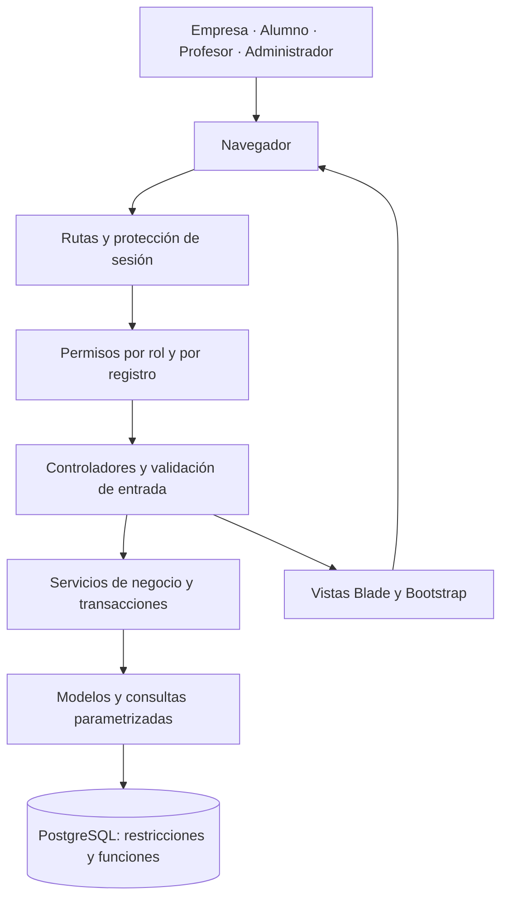

# Arquitectura y datos del banco de proyectos académicos

La arquitectura elegida es un monolito modular con Laravel, Blade y Bootstrap, confirmado por el usuario el 29 de octubre de 2026. Usa MVC y una capa de servicios de negocio: una aplicación web con módulos funcionales y una base PostgreSQL. Las vistas y las operaciones del servidor comparten el mismo origen. Esta estructura concentra los permisos y las transacciones que requieren las autorizaciones institucionales.

La elección de PostgreSQL se registra en [D-13](07-registro-de-decisiones.md#d-13) y su fundamento técnico en la [comparación de motores](04-eleccion-de-postgresql.md). El acuerdo de arquitectura y su base técnica están en [D-14](07-registro-de-decisiones.md#d-14). Las capacidades y políticas institucionales se consultan en el mismo registro; el [alcance](01-alcance-y-requisitos.md) desarrolla los requisitos correspondientes. El [plan web](03-plan-y-validacion.md#plan-de-inicio-de-la-parte-web) concreta el orden de implementación. WEB-01 preparó `web/`, portada y conexión propia; WEB-02 incorpora sesión, paneles y administración de cuentas por rol. WEB-03 aplica una guía visual compartida sobre esos recorridos. WEB-04 integra datos de empresa, borradores, habilidades, envío y resolución de publicación con historial. WEB-05 incorpora perfiles propios y catálogo autenticado con seis gateways de 022. WEB-06 integra participación y ciclo mediante ocho gateways de 023. WEB-07 incorpora avisos propios y cinco reportes administrativos mediante cuatro gateways de 024. Las comprobaciones y sus límites están en [el seguimiento](06-seguimiento.md).

## Tecnologías elegidas

| Componente | Elección | Motivo |
| --- | --- | --- |
| Servidor | PHP 8.5 y Laravel 13 | Continuidad con PHP de las prácticas y servicios del framework para acceso, validación, datos y pruebas |
| Interfaz | Blade, HTML, CSS propio, Bootstrap 5.3 y JavaScript puntual | Formularios y paneles adaptables con renderizado en servidor |
| Datos | PostgreSQL 18.6 local, UTF8, esquema `banco` y conexiones UTC | Reutilizar relaciones, restricciones y funciones implementadas |
| Dependencias | Composer; Node.js LTS compatible, npm y Vite para recursos de interfaz | Instalaciones reproducibles mediante archivos de bloqueo |
| Verificación | PHPUnit y pruebas HTTP de Laravel, integración contra PostgreSQL y recorridos de navegador | Comprobar permisos, flujos y concurrencia en el motor real |
| Control de cambios | Git | Repositorio local inicializado en `proyecto/`, rama `main`, todavía sin commits; excluye secretos, dependencias y datos locales |
| Ejecución | Entorno local de desarrollo; servidor institucional por definir | Acordar alojamiento antes de preparar el despliegue |

El entorno instalado en WEB-01 usa Laravel 13.40.0, PHP 8.5.12 NTS para Windows —revisión 1 del paquete oficial—, Composer 2.11.2, Node.js 24.14.1, npm 10.5.2, Vite 8.3.7, `laravel-vite-plugin` 3.2.1 y Bootstrap 5.3.8. `composer.lock` y `package-lock.json` fijan las dependencias. PHP y Composer locales permanecen en `.local/tools/`, sin cambiar el PATH global; `web/dev.ps1` también admite instalaciones de sistema. La [guía web](../web/README.md) explica la reproducción y el arranque. Fuentes: [compatibilidad de Laravel](https://laravel.com/framework/docs/13.x/releases), [versiones de PHP](https://www.php.net/supported-versions.php) y [recursos con Vite](https://laravel.com/framework/docs/13.x/vite).

Blade genera HTML en el servidor a partir de datos previamente autorizados, con plantillas y parciales compartidos. Bootstrap aporta estilos y componentes adaptables, complementados con CSS propio y compilados con Vite. La [guía visual](../web/DESIGN.md) es la referencia de presentación para estos componentes y los módulos siguientes. Fuentes: [Blade](https://laravel.com/framework/docs/13.x/blade) y [Bootstrap con Vite](https://getbootstrap.com/docs/5.3/getting-started/vite/).

Laravel aporta autenticación mediante sesión y cookies, además de mecanismos de autorización por recurso. WEB-02 incorpora Gates para cuentas y middleware de cuenta activa, versión de sesión y cambio inicial de contraseña. WEB-04 añade Gates de gestión empresarial y revisión administrativa; WEB-05 añade `gestionar-perfil` y `consultar-catalogo` para alumno/profesor activos. WEB-06 incorpora `participar`, `consultar-participacion` y `gestionar-ciclo` para contexto, consultas y operaciones administrativas. WEB-07 añade `consultar-avisos` para los cuatro roles y `consultar-reportes` solo para el administrador. Los gateways SQL revalidan rol activo y pertenencia o ámbito de lectura. El acceso a recursos de otros módulos se integra con sus recorridos. Fuentes: [autenticación](https://laravel.com/framework/docs/13.x/authentication) y [autorización](https://laravel.com/framework/docs/13.x/authorization).

Laravel usa la conexión `pgsql`, el controlador PHP `pdo_pgsql`, esquema `banco` y UTC. WEB-01 incluye un servicio y un comando de consola para verificar la conexión y sus permisos sin mostrar secretos; la portada pública no expone diagnósticos ni consulta datos personales. La base local existente es `banco_proyectos`, en `127.0.0.1:55432`; sus credenciales privadas no se copiarán a la documentación. Fuentes: [datos en Laravel](https://laravel.com/framework/docs/13.x/database) y [PDO PostgreSQL](https://www.php.net/manual/en/ref.pdo-pgsql.php).

El recorrido web es navegador → Laravel → PostgreSQL. Las APIs futuras tendrán controladores que devuelvan JSON y reutilicen los mismos servicios y comprobaciones de autorización; sus endpoints, contratos y autenticación se diseñarán en una etapa posterior. No forman parte del inicio web ni se añaden servicios independientes.

### Presentación compartida de WEB-03

La guía se concreta en [valores visuales](../web/design/design-tokens.json), variables de `resources/css/app.css`, una [muestra interactiva](../web/design/design-preview.html) y [wireframes](../web/design/wireframes.html). El layout principal comparte cabecera, navegación por rol y avisos; los parciales de cuentas reutilizan campos, contraseñas y errores. Los formularios conservan operaciones separadas y validación del servidor. El listado usa tabla desde 768 px y registros apilados por debajo, sin perder datos ni acciones.

Las páginas 403, 404, 419 y 503 usan `layouts/estado.blade.php`, independiente de la identidad de sesión: renderizar un fallo de servicio no debe provocar otra consulta de acceso. JavaScript solo mejora el estado de envío y foco del resumen; los formularios y navegación funcionan sin él. Las decisiones de presentación no añaden permisos, consultas SQL ni reglas de negocio a Blade.

La [matriz de habilidades](05-reglas-de-trabajo.md#selección-de-habilidades-antes-de-implementar) se consulta antes de cada bloque. La estructura se resuelve con wireframes, el acabado sigue la guía y la revisión comprende teclado, mensajes, estados, 390×844, 1440×900 y reflujo a 320 px. El seguimiento conserva la evidencia y los límites, sin convertir la guía en prueba de implementación completa o despliegue.

## Componentes y responsabilidades



| Capa | Responsabilidad |
| --- | --- |
| Rutas y middleware | Identificar la operación, exigir sesión y comprobar que la cuenta siga activa |
| Gates y Policies | Comprobar rol, propiedad del recurso y alcance de lectura o modificación; WEB-02 aplica Gates a cuentas, WEB-04 a gestión empresarial/revisión y WEB-05 a perfil propio/catálogo y WEB-06 a participación/ciclo; WEB-07 añade avisos propios y reportes administrativos; SQL revalida el ámbito del recurso |
| Validación de entrada | Form Requests para datos obligatorios, formatos, longitudes y referencias permitidas |
| Controladores | Coordinar la petición y devolver vista, redirección o error comprensible |
| Servicios de negocio | Coordinar casos de uso, transacciones y funciones SQL existentes; implementar solo políticas confirmadas |
| Modelos y consultas | Eloquent y Query Builder para relaciones, filtros autorizados y persistencia; SQL parametrizado para funciones y consultas que lo requieran |
| PostgreSQL | Mantener restricciones, integridad, bloqueos y operaciones SQL acreditadas; la base no identifica por sí sola la sesión web |
| Vistas | Blade para formularios y resultados, Bootstrap para presentación; nunca decidir por sí solas permisos o límites |

Los módulos compartirán identidad, servicios e infraestructura. Los cuatro roles tendrán navegación propia dentro de la misma aplicación:

| Módulo | Responsabilidad funcional |
| --- | --- |
| Acceso y cuentas | Sesión, usuarios administrados, rol y cuenta activa |
| Empresas y perfiles | Empresa, representante, perfiles de alumno y profesor y habilidades del alumno |
| Proyectos | Borrador, revisión, corrección, publicación y catálogo |
| Participación | Candidaturas, solicitudes de dirección, evaluación y preselección |
| Autorizaciones | Decisiones administrativas, asignaciones y condiciones de inicio |
| Consulta y comunicación | Historial, reportes y notificaciones según visibilidad y canal acordados |

Se agruparán controladores, servicios y vistas por módulo cuando tengan contenido real. Se crearán servicios para operaciones completas, como enviar proyecto o resolver publicación; no una clase por cada tabla ni repositorios genéricos sin una responsabilidad necesaria. Las vistas no consultarán PostgreSQL directamente.

## Organización

La aplicación está en `web/`, usando las convenciones de Laravel; `database/` conserva su función administrativa. Contiene los módulos descritos arriba, el modelo `Usuario`, los servicios y pruebas HTTP/integración. El esquema siguiente muestra sus carpetas principales:

```text
proyecto/
  Proyecto.pdf
  README.md
  docs/
  database/
    migrations/
    manage.py
    seed.sql
    sql/
    tests/
  web/
    app/
      Http/Controllers/
      Http/Requests/
      Http/Middleware/
      Models/
      Services/
    resources/
      views/
      css/
      js/
    routes/web.php
    tests/Feature/
    tests/Integration/
    public/
```

Las migraciones SQL de `database/migrations/` son la única fuente de evolución del esquema. El ejecutor actual seguirá siendo una herramienta de administración de la base, independiente de las peticiones web. El [modelo físico y diccionario](09-base-de-datos.md) concretan los tipos y controles. El script académico se exporta desde el esquema comprobado para evitar una segunda fuente mantenida a mano.

## Integración con PostgreSQL existente

1. **Conservar instalación e historial:** las migraciones aplicadas no se editarán. La base evoluciona mediante migraciones SQL numeradas; permisos de aplicación, tablas técnicas y demás cambios se incorporarán en nuevos archivos. Se retiraron las migraciones y semillas predeterminadas de Laravel para usuarios, caché y trabajos. El proveedor de la aplicación bloquea los comandos Artisan `migrate`, `migrate:*` y `db:wipe`. Las pruebas no reinician la base de trabajo.
2. **Adaptar modelos y autenticación:** mapear explícitamente esquema, tablas, claves y fechas; `banco.usuario` usa `correo_normalizado` y `hash_contrasena`, y los perfiles tienen `usuario_id`. El modelo `Usuario` declara `banco.usuario`, desactiva timestamps automáticos, oculta el hash y mapea `hash_contrasena`. `UsuarioProvider` de WEB-02 obtiene una cuenta por los gateways de acceso de 020, normaliza el correo y verifica bcrypt con el servicio de hash de Laravel; no consulta directamente la tabla con la credencial web. Los datos ficticios actuales no contienen contraseñas válidas de acceso. No se añadirá autorregistro por D-09.
3. **Separar las credenciales técnicas:** la web tiene una conexión LOGIN local propia, distinta de `proweb_admin`, sin superusuario, propiedad del esquema ni DDL. [019](../database/migrations/019_conexion_web.sql) conserva USAGE de `banco` y SELECT sobre el directorio mínimo para el grupo NOLOGIN `banco_web`. [020](../database/migrations/020_acceso_web.sql) añade once gateways de acceso y cuentas. [021](../database/migrations/021_publicacion_web.sql) añade nueve de empresa/publicación y siete auxiliares privados; no concede DML, SELECT general ni ejecución de esos auxiliares a la conexión web. [022](../database/migrations/022_perfiles_catalogo_web.sql) añade seis gateways de perfiles propios/catálogo y cinco auxiliares privados, sin tablas ni columnas nuevas. [023](../database/migrations/023_participacion_web.sql) añade ocho gateways de participación/ciclo y ocho auxiliares privados. [024](../database/migrations/024_avisos_reportes_web.sql) añade cuatro gateways de avisos/reportes y tres auxiliares privados; la conexión recibe treinta y ocho gateways en total. Esos gateways usan `SECURITY DEFINER`, búsqueda fija `pg_catalog,banco,pg_temp` y referencias calificadas. Los de lectura de autenticación entregan los nueve campos necesarios de una cuenta al servidor; las listas administrativas omiten hash. `database/provision_web.py` mantiene la credencial local y `.env` privados, comprobando la instalación en la base destino. Las funciones internas de negocio conservan `SECURITY INVOKER` y no se conceden directamente a la aplicación. La cuenta `proweb_admin` se mantiene para administración local.
4. **Reutilizar operaciones:** `PublicacionService` invoca los gateways `banco.web_*` de 021 con parámetros; estos llaman internamente a `banco.enviar_proyecto` y `banco.resolver_publicacion`. El actor procede de la sesión y Laravel aplica Gates; los gateways vuelven a validar rol/pertenencia y bloquean la fila estable. La empresa edita sus datos y proyectos propios; el administrador consulta todos para gestionar el proceso, pero no usa las operaciones empresariales de edición. No se sustituyen las resoluciones por cambios directos de estado ni se duplican sus eventos.
5. **Respetar transacciones:** las escrituras con integridad cruzada usarán READ COMMITTED. El alta de empresa, cuenta y representante usará la operación conjunta de D-09, respetando su restricción diferida. Se traducirán los rechazos SQL a mensajes comprensibles sin mostrar consultas ni datos privados. Las pruebas usarán bases temporales propias, migraciones reales y la credencial de aplicación para acreditar permisos.

WEB-04 incorpora el primer recorrido funcional acotado: empresa guarda borrador → envía → administrador publica, rechaza o devuelve → empresa consulta el motivo, corrige y reenvía. Los formularios y la consulta de historial siguen la guía visual; su verificación e instalación se acreditan en el seguimiento. Los avisos de envío y resolución se generan mediante 018 dentro de la misma transacción; WEB-07 incorpora su bandeja general de lectura. WEB-05 incorpora perfil propio y catálogo de alumno/profesor; WEB-06 integra perfiles compartidos por relación, solicitudes y ciclo con permisos específicos. WEB-01 usa sesiones y caché en archivos y cola síncrona, sin tablas técnicas adicionales. `.env.example` contiene valores de ejemplo sin secretos; `.env` conserva la clave de aplicación y credencial privada y está excluido de Git. Si otra etapa necesita tablas técnicas, se añadirán por la misma fuente SQL.

### Contrato de publicación de WEB-04

`EmpresaController`, `ProyectoController` y `Admin\RevisionProyectoController` reciben las peticiones; los Form Requests validan los campos y `PublicacionService` coordina lecturas, operaciones y errores. Las vistas reciben los datos autorizados y banderas de acciones calculadas en servidor. La edición empresarial no acepta cambios de empresa, autoría, estado o revisión publicada desde el formulario. Las habilidades se eligen del catálogo existente, sin cantidad mínima ni creación de habilidades desde este recorrido; nivel y obligatoriedad se normalizan antes del gateway.

La creación permite un borrador incompleto con título; al enviar se exigen título, descripción, problemática, objetivos, justificación, alcance y cupo positivo. Se guardan los demás datos admitidos sin inventar modalidades o duración institucionales. Cada envío crea una instantánea con su número de revisión. Al aprobar, el administrador confirma expresamente el cupo de esa revisión exacta, sin cambiarlo: una modificación requiere devolución y nuevo envío. El contenido y cupo publicados quedan congelados; rechazados o terminales no se reabren.

Empresa y proyecto usan tokens opacos SHA-256 de 64 caracteres para detectar formularios obsoletos, sin columnas nuevas. La versión no autoriza al actor: SQL valida la identidad recibida del servidor, el rol y la representación actual. El bloqueo precede a la comparación y escritura. Un conflicto `40001` pide recargar y revisar, sin repetir automáticamente la decisión; un interbloqueo técnico `40P01` admite reintento acotado de la transacción completa solo cuando no hay una transacción externa. El detalle administrativo se basa en la instantánea enviada y conserva decisiones y observaciones históricas.

### Contrato de perfiles y catálogo de WEB-05

`PerfilController` y `GuardarPerfilRequest` reciben el perfil del titular autenticado; `PerfilService` llama a los gateways de 022 con parámetros. `/perfil` permite a alumno/profesor crear el perfil que aún no exista o actualizar el propio. El alumno completa matrícula, carrera, semestre, datos académicos y contacto; selecciona habilidades duras/blandas del catálogo existente con dominio, descripción y evidencia. El profesor completa número de empleado, especialidad, experiencia y contacto. RF-26 no incorpora habilidades docentes estructuradas ni otra tabla; el catálogo de habilidades no recibe nuevas operaciones de administración.

La escritura usa una lista expresa de campos y obtiene el titular de sesión. No modifica identidad, credenciales, rol ni estado de cuenta. Guarda perfil, habilidades del alumno y auditoría en una transacción. El token opaco de 64 caracteres incluye el estado del perfil, sus habilidades y el último evento; funciona incluso antes de existir la fila y detecta cambios que luego vuelvan al mismo valor. La lectura compartida y escritura exclusiva del mismo titular usan un bloqueo asesor; los perfiles existentes se bloquean antes de Usuario. `40001` exige recargar conservando la versión y los datos enviados; `40P01` admite reintento acotado de la transacción completa solo fuera de una transacción externa.

`CatalogoController`, `FiltrarCatalogoRequest` y `CatalogoService` sirven `/catalogo` y su detalle exclusivamente a alumno/profesor activos que ya cambiaron su clave temporal, aunque aún no tengan perfil. La consulta combina búsqueda, empresa, modalidad, habilidad y tipo de habilidad, con páginas de 20. Habilidad y tipo se aplican a la misma habilidad de la instantánea. Los filtros disponibles proceden únicamente de publicaciones visibles.

El catálogo exige proyecto Publicado, seis campos obligatorios, revisión aprobada de formato 2, decisión administrativa de esa revisión, cupo positivo y contenido/requisitos coincidentes con lo autorizado. Las habilidades se muestran desde la instantánea aprobada, sin sustituir sus nombres por cambios posteriores del catálogo. El detalle bloquea el proyecto para revalidar su estado después de una operación concurrente y devuelve solo contenido autorizado y contacto empresarial, sin revisiones privadas, motivos o datos de acceso. Las plazas libres y la dirección disponible se calculan desde asignaciones vigentes: se incluyen proyectos con cero plazas y se indica si ya tienen director. Esa disponibilidad informa; no reserva, postula ni asigna. El enlace de participación abre el contexto de WEB-06; la consulta del catálogo no crea la solicitud.

La evidencia de habilidad permanece como texto escapado, incluso si contiene un enlace; no se convierte en enlace ejecutable ni admite archivos o descargas automáticas. Las vistas reutilizan los componentes de la guía visual y reciben datos ya autorizados. [El seguimiento](06-seguimiento.md) acredita las comprobaciones y el cierre; este contrato describe la implementación, no una prueba ejecutada.

### Contrato de participación y ciclo de WEB-06

`ParticipacionController`, `SeguimientoController`, las peticiones de `Http/Requests/Participacion/` y `ParticipacionService` integran las operaciones de 023. La presentación usa listas y detalles por recurso: `/participacion/candidatura`, `/participacion/direccion` y `/seguimiento/proyectos`. Los listados combinan `buscar` y `estado` y paginan de veinte en veinte. El contexto `/catalogo/{proyecto}/participar` permite revisar el envío sin reservar plaza o carga; exige perfil académico existente y, para dirección, experiencia aplicable y justificación. No limita a tres las solicitudes docentes pendientes ni impide postularse al alumno por tener otra asignación.

Tres Gates verifican las capacidades generales: `participar` para alumno/profesor, `consultar-participacion` para los cuatro roles y `gestionar-ciclo` para administrador, siempre con cuenta activa y clave temporal cambiada. Las peticiones validan acción, datos y rol; el servicio obtiene el actor de sesión y llama únicamente los ocho gateways parametrizados. Cada lectura aplica pertenencia y devuelve datos y acciones autorizados. El alumno consulta sus candidaturas/evaluaciones/decisiones, el profesor sus solicitudes, la empresa las candidaturas de sus proyectos y el administrador los registros de gestión. Los perfiles compartidos excluyen identificadores académicos reservados y datos de acceso; el profesor asignado vigente consulta solo los alumnos vigentes de su proyecto y no recibe evaluaciones empresariales. Una vacante durante Pausado permite consultar el proyecto para reponer el tipo faltante, sin abrir perfiles de otros participantes.

Las mutaciones comparan una versión opaca del contexto, solicitud o ciclo. El envío considera perfil, publicación, actividad y existencia de solicitud; las decisiones conservan la evaluación y preselección exactas, y el ciclo considera sus fuentes y asignaciones. Las lecturas y escrituras usan bloqueos compatibles con los procedimientos internos. Un conflicto `40001` pide recargar sin repetir la decisión; solo un interbloqueo técnico `40P01` se reintenta de forma acotada fuera de otra transacción. No se reciben actor, estado o decisión del navegador como autoridad. Perfil, evaluación, decisión, asignación, auditoría y avisos mantienen los efectos atómicos de cada operación SQL.

El titular cancela su solicitud activa antes de la asignación, sin motivo obligatorio; el retiro posterior y el cierre los realiza el administrador con motivo. Evaluar, preseleccionar y asignar son acciones separadas. Iniciar o reanudar requieren confirmación administrativa; una reposición durante Pausado no reanuda automáticamente. Se conservan las reglas D-01 a D-11 y las funciones internas de integridad ya existentes, sin reapertura, cambios publicados, incorporación general En curso, APIs o servicios externos. El alcance instalado, las pruebas y los límites se consultan en [el seguimiento](06-seguimiento.md).

### Contrato de avisos y reportes de WEB-07

`AvisoController`, `ReporteController`, las peticiones de `Http/Requests/Consultas/` y `ConsultaService` coordinan las cuatro entradas de 024. `consultar-avisos` permite a los cuatro roles activos con clave temporal cambiada consultar `/avisos` y su detalle; `consultar-reportes` limita `/reportes/{tipo?}` al administrador, de acuerdo con RF-41. El actor procede de sesión y SQL revalida rol, actividad y propiedad. Los filtros usan listas permitidas y parámetros, sin construir SQL desde nombres recibidos.

La bandeja filtra por búsqueda y lectura (`todos`, `no_leidos`, `leidos`), con páginas de 20 y contador propio de no leídos. GET de detalle solo consulta. POST `/avisos/{aviso}/leer`, protegido con CSRF, reutiliza la operación idempotente de 018 y conserva la primera fecha de lectura. La respuesta contiene únicamente mensaje, fechas y un recurso navegable si continúa autorizado; Laravel construye su enlace desde rutas internas permitidas. El aviso permanece aunque ese recurso deje de estar disponible; nunca se devuelve el evento crudo ni sus motivos privados.

Los reportes son proyectos, candidaturas, solicitudes de dirección, carga de profesores y participantes asignados. Combinan búsqueda con los estados e identificadores aplicables a cada tipo; un filtro de otro tipo se rechaza. Las filas se paginan de 20 en 20 y los totales proceden del mismo conjunto filtrado antes de paginar. La carga docente cuenta asignaciones vigentes, incluso de cuentas inactivas, e incluye profesores sin carga. Se muestran datos de gestión expresos sin credenciales, identificadores académicos reservados, rúbricas o evidencias. No hay exportación, correo, API o actualización automática de pantalla. La [guía web](../web/README.md#avisos-y-reportes) desarrolla el uso y [el seguimiento](06-seguimiento.md) acredita pruebas e instalación.

### Alta administrativa inicial

[010 Alta de cuentas](../database/migrations/010_alta_cuentas.sql) incorpora dos operaciones internas de RF-02/RF-03 y D-09:

| Función | Contrato |
| --- | --- |
| `banco.crear_cuenta(admin_id,nombre,correo,hash,rol)` | Devuelve el ID de una cuenta de alumno, profesor o administrador. No crea ni exige el perfil académico inicial; matrícula y número de empleado no se inventan |
| `banco.crear_empresa_con_representante(admin_id,nombre,correo,hash,razon_social)` | Devuelve `usuario_id` y `empresa_id`; crea una empresa nueva, su cuenta y representación vigente en la misma transacción. Identificación y contactos de RF-07 siguen opcionales para completarlos después |

Ambas comprueban administrador activo, normalizan el correo como `lower(btrim(correo))` y registran actor, fecha y operación sin copiar hash ni correo al evento. Ante un fallo se revierten cuenta, empresa, representación y auditoría que correspondan. Son funciones `SECURITY INVOKER` del propietario y no conceden permisos a la aplicación. WEB-02 obtiene el administrador de la sesión, verifica Gates y usa los gateways de 020 para invocarlas; el ID suministrado a SQL no autentica a una persona. La credencial de servidor es una capacidad de aplicación confiable, no un permiso entregado al navegador.

El hash se recibe como valor opaco ya generado fuera de SQL; no se altera, se calcula ni se valida su algoritmo o coste en estas funciones. WEB-02 genera bcrypt mediante Laravel, exige cambio de claves temporales y comprueba la actual al cambiarla el titular. Los ensayos SQL históricos de 010 usan valores ficticios y siguen separados de la evidencia HTTP de autenticación. No hay invitaciones, envío externo o recuperación pública de contraseñas. D-10 define la gestión posterior, bajas, relevo y matriz de acceso; D-11 define los avisos internos. La evidencia aislada y la integración de este bloque se consultan en [el seguimiento](06-seguimiento.md), distinguiendo el alcance SQL histórico de la integración de WEB-02.

### Sesión y administración de WEB-02

El guard de sesión usa `UsuarioProvider` y no mantiene un inicio persistente de «recordarme». Una autenticación válida regenera la sesión y registra `inicio_sesion`; el cierre POST invalida sesión y token y registra `cierre_sesion` cuando la base está disponible. Un fallo al registrar no conserva una sesión local abierta. La cuenta se vuelve a leer en cada petición protegida y se compara `version_acceso`; una cuenta inactiva, ausente o modificada termina el acceso anterior. Los cambios de nombre, correo, rol, estado, hash o requisito de cambio incrementan esa versión desde SQL.

El middleware impide usar panel, cuentas y módulos protegidos mientras `requiere_cambio_clave` siga activo. El cambio propio verifica contraseña actual, confirmación, mínimo de 12 caracteres, máximo de 72 bytes y valor distinto; renueva la sesión actual. Bcrypt usa coste 12 en el entorno de aplicación. Las pruebas pueden reducir el coste exclusivamente en su entorno aislado. Las cookies son HttpOnly y SameSite=Lax, y las sesiones se almacenan cifradas en archivos. El transporte local usa loopback HTTP; HTTPS y cookies Secure se configuran al desplegar conforme a D-12.

Los controladores coordinan Form Requests, Gates y servicios; las vistas no calculan permisos. `CuentaService` llama con parámetros a los gateways para altas de los cuatro roles, empresa/representante conjunta, edición de nombre/correo, estados, restablecimiento temporal y relevo. Los roles se asignan al crear y no se convierten perfiles. La administración no recibe hashes en consultas ni devuelve contraseñas en mensajes o formularios. El administrador entrega temporalmente la clave fuera de la aplicación; el titular debe cambiarla.

Las ediciones, estado y restablecimiento comparan la versión leída por el formulario; el relevo compara el representante exacto bajo bloqueo. `40001` por versión obsoleta requiere recargar datos, no repetir automáticamente el mismo formulario. Un interbloqueo puede reintentarse de forma acotada si la operación posee la transacción completa; en una transacción externa se devuelve un rechazo controlado. Los gateways conservan auditoría y avisos de acceso en la misma transacción sin copiar hash, clave o correo al evento.

El ingreso limita cinco intentos fallidos por correo/IP y veinte por IP durante un minuto; el rechazo posterior usa HTTP 429. Los mensajes no revelan si una cuenta existe y la bitácora de intentos usa una referencia opaca. La protección CSRF del framework permanece activa en acciones con cambios. Las páginas protegidas usan no-store; el primer administrador se prepara mediante herramienta local y archivo privado, nunca mediante una ruta pública o contraseña de las semillas. [D-09/D-10](07-registro-de-decisiones.md#d-09) registran estas concreciones y [el seguimiento](06-seguimiento.md) conserva los casos comprobados.

## Modelo conceptual inicial

La fuente del diseño de entidades, atributos y cardinalidades es [08 Modelo entidad-relación](08-modelo-entidad-relacion.md). Desarrolla las páginas 8 y 9 del PDF en una lámina general y cinco áreas, con 21 entidades, 37 relaciones de referencia y dependencias institucionales expresas. La [entrega académica 01](../tareas/01-modelo-entidad-relacion/README.md) conserva PDF, SVG y fuentes. Las claves físicas, tipos, nulabilidad, índices y límites implementados se consultan en [09 Base de datos física](09-base-de-datos.md).

El modelo distingue Usuario de Empresa y propone RepresentacionEmpresa para aplicar [D-09](07-registro-de-decisiones.md#d-09): una sola empresa por cuenta, un representante activo por empresa e identidad histórica conservada. Empresa mantiene la pertenencia de sus proyectos.

Las candidaturas, solicitudes de dirección, decisiones y asignaciones son registros distintos. Las relaciones históricas no fijan capacidades simultáneas. Las asignaciones de alumno y dirección se separan conforme a RF-37 y RF-38. [D-03](07-registro-de-decisiones.md#d-03) confirma como máximo un director vigente por proyecto, sin codirección ni gestión de equipos; su índice por proyecto está implementado. Acompanamiento conserva la correspondencia de las asignaciones autorizadas dentro del mismo proyecto y sus vigencias compatibles. D-05 exige inicio administrativo sobre al menos un alumno y el director autorizados. D-07 define retiro administrativo, pausa, reposición del tipo faltante, reanudación expresa y cierre coordinado, sin altas generales En curso ni reapertura.

RevisionProyecto conserva la instantánea de contenido y requisitos que recibe una resolución. La publicación inicial ya cuenta con ese control; D-07 mantiene congelados contenido y cupo publicados. Un cambio sustantivo requiere un proyecto nuevo, sin incorporar otra revisión de la publicación en la primera versión. DecisionAdministrativa tiene FK hacia sus objetos concretos y una comprobación de objeto único. El historial de auditoría no sustituye esas relaciones. El documento del modelo desarrolla la evaluación de D-08 y la privacidad y notificación de D-10/D-11 sin alterar las láminas académicas de su fecha.

[D-02](07-registro-de-decisiones.md#d-02) confirma un cupo máximo de alumnos propio de cada proyecto, propuesto por la empresa y validado por el administrador antes de publicar. La migración 004 incorpora `cupo_maximo_alumnos`, positivo y sin valor por defecto, y lo conserva en la instantánea de formato 2. La aprobación valida el valor exacto revisado antes de publicar; no reescribe las revisiones antiguas ni les inventa un cupo. La migración 006 protege el máximo de asignaciones vigentes. D-02 no limita candidaturas recibidas ni incorpora equipos o varios directores.

La migración 011 implementa y verifica el rechazo de texto compuesto solo por blancos en los seis campos de RF-08 y en los motivos administrativos de RF-40. Mantiene las mismas obligaciones funcionales; no vuelve obligatorios otros datos operativos ni una cantidad mínima de habilidades.

## Integridad y concurrencia

RNF-04 exige impedir duplicados y exceso de cupos incluso con solicitudes simultáneas. La base usa READ COMMITTED, bloqueos sobre filas estables y recuentos posteriores a la espera. Las reservas nuevas siguen participante → proyecto; las operaciones de una fuente existente bloquean primero la candidatura o solicitud. El conteo posterior ve los cambios confirmados por quien liberó el bloqueo. Fuentes: [aislamiento](https://www.postgresql.org/docs/18/transaction-iso.html) y [bloqueos de PostgreSQL](https://www.postgresql.org/docs/18/explicit-locking.html).

Los contratos SQL internos se invocan mediante parámetros y no autentican el ID recibido. La futura aplicación obtendrá el actor de la sesión y comprobará permisos por recurso. El [seguimiento](06-seguimiento.md) y [09 Base de datos física](09-base-de-datos.md) distinguen fuentes, instalación y pruebas de cada operación; no se deduce su despliegue de esta descripción.

### Reservas y formalización

D-01/D-06 cuentan como candidaturas activas `pendiente_evaluacion`, `evaluada` y `preseleccionada`, con máximo global de tres y unicidad activa alumno/proyecto. Rechazadas y canceladas válidamente no cuentan. `banco.presentar_candidatura` comprueba alumno activo, publicación válida y límites, sin reservar una plaza ni exigir que el alumno carezca de otra asignación. `banco.solicitar_direccion` exige profesor activo, experiencia y justificación y crea una solicitud pendiente; no impone un máximo de tres solicitudes ni reserva carga docente.

La asignación `vigente` reserva desde la autorización, incluso antes del inicio: alumno ocupa una plaza del cupo aprobado de D-02 y su máximo global de un proyecto de D-04; director ocupa la única dirección de D-03 y uno del máximo de tres proyectos del profesor. Las asignaciones `finalizada` o `revocada` liberan esos límites y conservan historial. Las candidaturas recibidas, solicitudes docentes pendientes y número de alumnos no multiplican la carga docente.

Las claves compuestas y los controles diferidos exigen origen aprobado, decisión aprobatoria y asignación exacta al confirmar. Un fallo revierte aprobación, reserva y liberación de candidatura; no cancela las demás candidaturas. Revisar, publicar, vencer una fecha estimada o desactivar una cuenta tampoco libera cargas por sí mismo.

### Evaluación y autorización de D-08

La evaluación empresarial aplica tres criterios manuales —conocimientos técnicos, habilidades blandas y requisitos académicos— con puntuación 0, 1 o 2, igual ponderación y comentario por criterio, más comentario general y recomendación. `banco.evaluar_candidatura` crea evaluación y detalles atómicos, con copia de la definición aplicada. El control diferido exige completar la rúbrica versionada; los registros anteriores se conservan sin fabricar puntuaciones.

Reevaluar crea otra evaluación inmutable y devuelve la candidatura a Evaluada, invalidando la preselección anterior. `banco.preseleccionar_candidatura` registra una selección expresa ligada a la última evaluación completa favorable. No existe nota mínima automática ni asignación por puntuación.

`banco.resolver_candidatura` aprueba solo desde esa preselección y crea decisión, asignación y auditoría juntas; puede rechazar una candidatura activa con motivo sin exigir una evaluación innecesaria. `banco.resolver_direccion` resuelve una solicitud pendiente, con experiencia y justificación al aprobar, sin evaluación empresarial del profesor. Ambas operaciones comprueban administrador activo y revalidan disponibilidad, cupo y carga; repetir el mismo resultado devuelve la decisión histórica sin otra formalización. El orden es fuente → participante → proyecto, compatible con la cancelación y el cierre.

### Continuidad y cierre de D-07

| Operación interna | Responsabilidad |
| --- | --- |
| `banco.cancelar_candidatura` | Alumno activo cancela una candidatura propia activa antes de asignación; audita y libera candidatura sin motivo obligatorio ni cambios en otras solicitudes |
| `banco.cancelar_solicitud_direccion` | Profesor activo cancela su propia solicitud pendiente antes de asignación, conservando historial |
| `banco.iniciar_proyecto` | Administrador confirma Publicado → En curso con cupo validado, al menos un alumno y el director autorizados; sin llenar plazas ni inicio automático |
| `banco.retirar_alumno` y `banco.retirar_director` | Administrador activo retira una asignación con motivo, cierra acompañamientos afectados y pausa si En curso pierde el mínimo; conserva las otras vigencias y cargas |
| `banco.reanudar_proyecto` | Administrador confirma la reanudación y revalida publicación, cupo, cargas y mínimo; reponer no reanuda por sí solo |
| `banco.finalizar_proyecto` y `banco.cancelar_proyecto` | Administrador activo cierra el proyecto con motivo y evento común, coordinando asignaciones, acompañamientos y solicitudes pendientes |

Durante Pausado se tramitan pendientes o nuevas solicitudes solo del tipo faltante, con autorización normal de D-08. No se habilitan incorporaciones generales En curso. Finalizar requiere En curso; cancelar admite cualquier estado abierto. El cierre deja asignaciones y acompañamientos finalizados o revocados, cancela candidaturas activas, solicitudes de dirección y revisión pendientes y libera sus reservas. Las fuentes aprobadas y decisiones originales permanecen. Los períodos no iniciados conservan `inicio`, `fin` NULL y evento exacto de retiro/cierre, sin finales futuros ficticios.

Los enlaces de auditoría conservan primer inicio, cadena de pausas/reanudaciones y cierre. Una revisión pendiente se cancela sin fabricar una decisión de rechazo. Registros rechazados, cancelados o finalizados no se reabren; el contenido y cupo publicados quedan congelados. Cambios sustantivos requieren un proyecto nuevo y, si corresponde, cancelar el anterior.

El cierre bloquea fuentes y participantes en orden estable antes del proyecto y revalida el alcance después de esperar. Si una autorización concurrente cambió ese alcance, rechaza con `40001` antes de mutar, para reintentar la transacción completa. La futura integración tratará reintentos de serialización o interbloqueo de forma acotada; nunca confirmará solo parte de un cierre. La pérdida del mínimo y la reanudación siguen protegidas al confirmar, sin ciclos artificiales de pausa durante el cierre definitivo.

Los controles estructurales incluyen claves foráneas reales, objeto único de decisión, unicidad de correo/matrícula/número de empleado, representación empresarial exacta, habilidades sin parejas duplicadas, origen/aprobación exactos e historial inmutable. Los índices parciales limitan candidaturas y asignaciones vigentes conservando registros anteriores. Fuente: [índices parciales de PostgreSQL](https://www.postgresql.org/docs/18/indexes-partial.html). La evidencia real de restricciones y concurrencia se consulta en el seguimiento.

## Tipos y comparación de datos

La base usa UTF8 para el texto; `timestamptz` para instantes de candidatura, autorización y auditoría, con UTC en conexiones y conversión al presentar; y `date` para fechas académicas que representan un día. `timestamptz` conserva el instante y no el nombre original de la zona. Fuente: [fechas de PostgreSQL](https://www.postgresql.org/docs/18/datatype-datetime.html).

La aplicación tratará el correo como ya exige la base: eliminar espacios externos y normalizar al guardar y autenticar, respetando la unicidad de la forma normalizada. Fuente técnica: [restricciones de PostgreSQL](https://www.postgresql.org/docs/18/ddl-constraints.html).

Las revisiones guardan su contenido estructurado en `jsonb`, con versión del formato. Participantes, solicitudes y decisiones conservan columnas y claves foráneas. Las funciones y restricciones protegen expresamente las instantáneas; el tipo JSONB por sí solo no proporciona inmutabilidad. Fuente: [tipos JSON](https://www.postgresql.org/docs/18/datatype-json.html).

## Seguridad y privacidad

WEB-02 almacena contraseñas con el servicio de hash del framework y aplica cookies protegidas, regeneración al autenticar, cierre e invalidación y caducidad. Mantiene CSRF y límites de intentos; las pruebas de estos controles se ejecutan sobre peticiones y PostgreSQL aislados. La autorización por registro se aplicará también a consultas y descargas.

Las consultas usarán parámetros y la interfaz escapará contenido ingresado por usuarios. Las cuentas inactivas perderán acceso aunque tengan una sesión previa. Según D-10, desactivar requiere administrador, motivo e historial, bloquea acciones nuevas y conserva asignaciones y carga. El relevo empresarial crea una nueva cuenta en una operación atómica, deja inactiva la anterior y conserva la empresa y autoría histórica; no se desactiva al único representante sin relevo ni al último administrador activo.

D-10 limita la lectura por pertenencia: titular de perfil y solicitudes, empresa sobre candidatos propios, profesor sobre alumnos asignados y administrador según su gestión. Los perfiles compartidos excluyen matrícula, número de empleado, correo de acceso, hashes y datos administrativos; el contacto compartido procede del perfil. Las evaluaciones empresariales privadas no se exponen al profesor. Reportes y avisos respetan el mismo ámbito.

D-11 admitía al inicio evidencia solo como texto o enlace escrito; desde el 12 de noviembre de 2026 admite además PDF de evidencias y currículum (máximo 5 MB, almacenamiento privado y descarga autorizada conforme a D-10), con implementación pendiente. El texto se presenta escapado y se consulta conforme a D-10. No hay purga automática en la primera versión local; la retención legal de producción se concretará con la institución. Las bitácoras evitarán contraseñas, tokens y datos personales innecesarios.

## Notificaciones y despliegue

D-11 define una bandeja interna persistente para RF-42. Los eventos generan avisos a destinatarios relacionados con cuenta activa, dentro de la misma transacción y sin duplicados por evento/destinatario. Un fallo revierte también el cambio de negocio. Cada usuario consulta y marca solo sus propios avisos; leer no borra ni modifica el evento. Los mensajes no incluyen motivos privados, puntuaciones, evidencias ni correos de acceso; el detalle exige la visibilidad de D-10. El cierre genera el aviso conjunto sin duplicarlo por cada solicitud cerrada automáticamente.

La primera versión no incluye correo, SMS, tiempo real ni servicios de entrega externos.

Para operación institucional se necesita un servidor con PHP compatible y `pdo_pgsql`, servidor web y PostgreSQL con soporte vigente, HTTPS, configuración privada, acceso restringido a la base y respaldos verificados. El directorio público será el punto de entrada web del framework. El alojamiento, responsables, carga y compromisos institucionales se concretarán al preparar el despliegue, conforme a D-12; son datos externos todavía desconocidos.

La entrega de la base utiliza un respaldo lógico mediante `pg_dump` y una restauración comprobada con `pg_restore` para formato custom; las migraciones iniciales preparan los grupos técnicos y sus permisos. D-12 define respaldo manual previo a actualizar y recuperación local en otro destino; los tiempos y la retención institucionales se concretarán para producción. La [guía PostgreSQL](../database/README.md#recuperación-local) explica propietario, roles y restauración; la [guía web](../web/README.md#actualizar-y-recuperar-la-aplicación) cubre dependencias, configuración, clave de aplicación y sesiones que quedan fuera del respaldo SQL. Fuente: [respaldo lógico de PostgreSQL](https://www.postgresql.org/docs/18/app-pgdump.html). El [seguimiento](06-seguimiento.md) acredita las comprobaciones y el cierre local; la aplicación no está desplegada institucionalmente.
