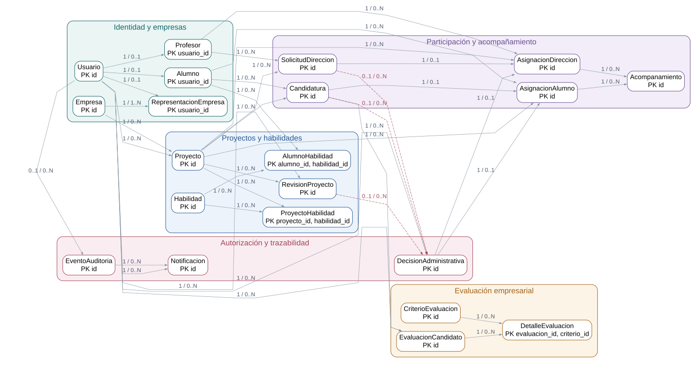
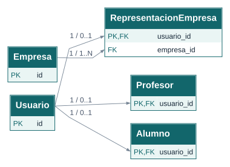
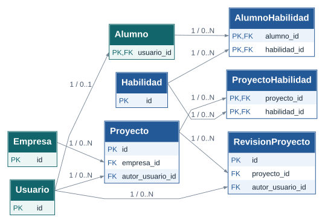
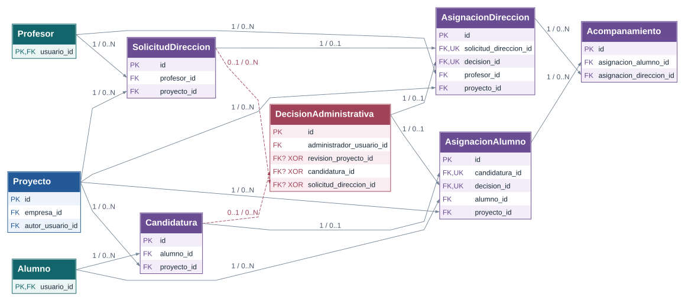
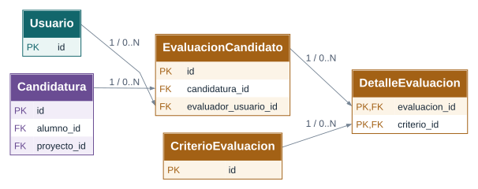
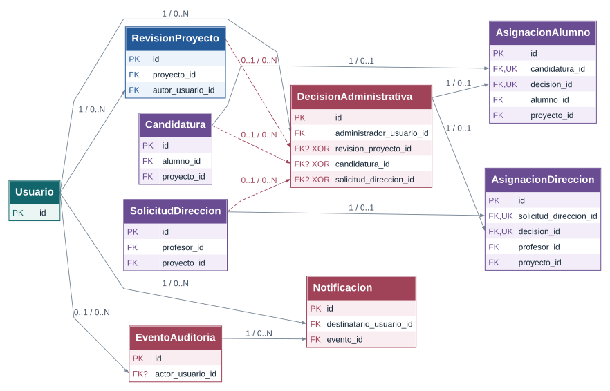

# Modelo entidad-relación del sistema

Actualización documental: 10 de noviembre de 2026, para incorporar las resoluciones de D-01 a D-11 y la base local de D-12, distinguiendo acuerdos expresos y concreciones por delegación del usuario. Se conservan el modelo de diseño 1.0 y la revisión editorial 1.1 de la entrega académica del 27 de octubre, desarrollados a partir del preliminar F1-01 del 25 de octubre. Este documento desarrolla las entidades de las páginas 8 y 9 de [Proyecto.pdf](../Proyecto.pdf), los [requisitos](01-alcance-y-requisitos.md) y los acuerdos del [registro de decisiones](07-registro-de-decisiones.md). La arquitectura y los criterios de persistencia permanecen en [02 Arquitectura y datos](02-arquitectura-y-datos.md).

El modelo académico conserva **21 entidades y 37 relaciones de referencia**, con una lámina general de todo el sistema y cinco vistas por áreas. La [entrega 01](../tareas/01-modelo-entidad-relacion/README.md) conserva el [PDF](../tareas/01-modelo-entidad-relacion/modelo-entidad-relacion.pdf), los SVG y las fuentes editables de su fecha. Sus atributos orientaron el esquema PostgreSQL; los tipos, nulabilidad, índices y controles instalados se consultan en el diccionario físico. Las evoluciones posteriores, como el cupo y el enlace al evento de inicio descritos abajo, no reescriben retroactivamente las láminas académicas.

Para presentar al profesor se preparó una [vista conceptual breve con Chen simplificada y flujo](../tareas/01-modelo-entidad-relacion/modelo-conceptual-y-flujo.pdf), de tres páginas A4 horizontales. Expone siete entidades principales y representa evaluación, resolución y participación mediante relaciones del negocio. Es una proyección del sistema para comunicarlo; este documento conserva el detalle lógico y desarrolla las decisiones vigentes. La identidad de los participantes, las habilidades y los registros de control siguen desarrollados en el modelo detallado.

Desde el 28 de octubre, el desarrollo de la base se concreta en [09 Base de datos física](09-base-de-datos.md) y [las migraciones SQL](../database/README.md). Allí se documentan tipos, nulabilidad, índices y controles adicionales de coherencia. El modelo académico y sus PDF se conservan como fuentes de diseño; el avance de implementación se consulta en el seguimiento.

## Modelo general de todo el sistema

La lámina conecta todas las entidades y representa todas las FK de la [fuente editable](../tareas/01-modelo-entidad-relacion/fuentes/modelo.json), incluidas autoría, participante y proyecto de las asignaciones, evaluador, destinatario y objeto de decisión. Muestra nombres y PK; las vistas por áreas detallan PK/FK y el catálogo conserva los atributos completos. Los colores agrupan áreas del mismo sistema, sin separarlas en bases de datos independientes.

El informe PDF introduce el funcionamiento y la notación antes del modelo general, reúne explicaciones y ejemplos junto a las áreas y añade un caso práctico con las ramas de alumno y profesor diferenciadas. Su presentación uniforme A3 horizontal y sus textos editables se conservan en la carpeta de la entrega. Esta revisión editorial mantiene intactas las 21 entidades, las 37 relaciones y las decisiones institucionales.

## Lectura y límites

- `1` significa exactamente uno; `0..1`, opcional y único; `0..N`, ninguno o varios; `1..N`, uno o varios. La flecha va de la entidad referenciada hacia la entidad con FK. La etiqueta `A / B` indica multiplicidad de origen y destino, respectivamente. Así, Empresa → Proyecto con `1 / 0..N` significa una empresa por proyecto y cero o varios proyectos por empresa.
- Las relaciones con varias solicitudes o asignaciones representan el historial. No autorizan capacidad simultánea ilimitada: D-01 fija como máximo tres candidaturas activas simultáneas por alumno; D-02, un cupo propio de alumnos por proyecto validado antes de publicar; D-03, una dirección vigente por proyecto; y D-04, un proyecto asignado simultáneamente por alumno. D-05 concreta el inicio administrativo con al menos un alumno y un director autorizados, publicación y cupo validado, sin llenar obligatoriamente las plazas. D-06 confirma estados computables y reserva desde autorización; D-07 define cancelaciones, continuidad y cierre, sin reapertura ni edición de contenido publicado.
- PK identifica una entidad; FK refiere a otra. Varios campos PK forman juntos una clave compuesta. UK indica unicidad propuesta; `UK*` en RevisionProyecto significa `(proyecto_id, numero)`. Los enlaces orientan el futuro diseño relacional, sin acreditar restricciones implementadas.
- D-01 fija el conteo de candidaturas activas simultáneas, sin exigir periodo académico para ese límite; D-02 fija el cupo máximo por proyecto, propuesto por la empresa y validado por el administrador antes de publicar; D-03 fija la dirección única vigente, sin codirección ni gestión de equipos; D-04 fija un máximo de un proyecto asignado simultáneamente por alumno; D-05 fija las condiciones y confirmación administrativa de inicio; D-06 fija qué estados cuentan y desde cuándo reservan capacidad; D-09 fija las altas administrativas y la representación empresarial; D-13 fija PostgreSQL. D-07/D-08 concretan ciclo y evaluación; D-10/D-11 concretan privacidad y avisos. Sus fuentes y alcance se consultan en el registro; dibujar una alternativa no la convierte en acuerdo.
- Los diagramas son vistas del mismo modelo: una entidad repetida conserva su identidad. La vista general incluye todas las relaciones; las de área muestran las relaciones internas entre sus entidades.

## Identidad y representación empresarial

| Entidad | Identificación y relaciones propuestas | Atributos principales |
| --- | --- | --- |
| Usuario | PK `id`; UK `correo_normalizado` | Nombre, correo, hash de contraseña, rol principal, estado y fecha de alta |
| Alumno | PK y FK `usuario_id` → Usuario; UK `matricula` | Carrera, semestre y datos académicos y de contacto |
| Profesor | PK y FK `usuario_id` → Usuario; UK `numero_empleado` | Especialidad, experiencia y datos académicos y de contacto |
| Empresa | PK `id` | Razón social, sector y datos de identificación y contacto |
| RepresentacionEmpresa | PK y FK `usuario_id` → Usuario; FK `empresa_id` → Empresa | Vigencia del vínculo, fecha de vinculación y fecha de fin si corresponde |

Cada cuenta tiene un rol principal entre empresa, alumno, profesor y administrador, conforme a RN-01. Los perfiles opcionales del diagrama permiten crear primero la cuenta y después completar sus datos; el perfil utilizado debe corresponder al rol. El administrador se representa mediante Usuario con ese rol, sin crear una entidad adicional carente de datos propios.

**Aplicación de D-09:** el administrador crea las cuentas. RepresentacionEmpresa es una propuesta técnica para separar la cuenta personal de la empresa: su PK `usuario_id` permite un solo vínculo empresarial por cuenta, mientras Empresa conserva los vínculos de representantes anteriores. Cada empresa debe tener exactamente un representante vigente con cuenta activa; el diagrama `1..N` expresa los representantes conservados, no varios representantes activos. La base física ya protege la unicidad vigente y existencia de ese representante al confirmar la transacción.

La vigencia del vínculo y el estado de la cuenta son conceptos distintos. D-10 define el relevo administrativo atómico: una nueva cuenta representa a la misma empresa, la anterior queda inactiva y conserva su vínculo histórico. No se traslada una cuenta a otra empresa ni se deja una empresa sin representante activo. Desactivar una cuenta conserva participaciones y carga; no se desactiva al último administrador activo. La autoría conserva al Usuario que realizó la operación aunque cambie el representante. RF-07 permite completar los datos propios de la empresa, sin crear cuentas.

## Proyectos, revisiones y habilidades

| Entidad | Identificación y relaciones propuestas | Atributos principales |
| --- | --- | --- |
| Proyecto | PK `id`; FK `empresa_id` → Empresa; FK `autor_usuario_id` → Usuario; enlace físico de inicio a EventoAuditoria | Título, descripción, problemática, objetivos, justificación, alcance, requisitos académicos, duración, modalidad, fechas, recursos, estado y cupo máximo de alumnos de D-02 |
| RevisionProyecto | PK `id`; FK `proyecto_id` → Proyecto; FK `autor_usuario_id` → Usuario; UK `(proyecto_id, numero)` | Número, fecha, estado de revisión e instantánea del contenido y requisitos enviados |
| Habilidad | PK `id` | Nombre, tipo dura o blanda y descripción |
| AlumnoHabilidad | PK propuesta `(alumno_id, habilidad_id)`; FK → Alumno y Habilidad | Nivel de dominio, descripción y evidencia |
| ProyectoHabilidad | PK propuesta `(proyecto_id, habilidad_id)`; FK → Proyecto y Habilidad | Nivel mínimo y obligatoriedad |

Empresa es propietaria de Proyecto; `autor_usuario_id` identifica quién lo registró. El servidor comprobará que ese autor representa a la empresa correspondiente al efectuar la operación. La pertenencia del proyecto no cambia al desactivar la cuenta del autor.

**Aplicación de D-02:** cada proyecto tiene un cupo máximo de alumnos, propuesto por su empresa y validado por el administrador antes de publicarlo. SQL incorpora `cupo_maximo_alumnos` como entero positivo si está informado, opcional en borrador y obligatorio al enviar, sin cifra universal ni valor por defecto. La instantánea de formato 2 conserva la propuesta y la aprobación valida el valor exacto revisado, junto con los seis campos de RF-08. Se preservan las revisiones antiguas sin inventarles cupos. Estos cambios físicos están implementados y probados; las fuentes JSON, PDF y SVG académicas conservan el diseño de su fecha.

La relación Proyecto → AsignacionAlumno conserva `0..N` registros históricos; el cupo limita las asignaciones vigentes según D-06, no el total histórico ni las candidaturas recibidas. Puede haber varios alumnos asignados individualmente al mismo proyecto y director sin incorporar gestión de equipos. D-04 fija como máximo un proyecto asignado simultáneamente por alumno y D-05 permite iniciar sin llenar las plazas cuando haya publicación, cupo validado y al menos un alumno y un director autorizados, con confirmación administrativa. D-07 mantiene congelados contenido y cupo publicados; un cambio sustantivo requiere un proyecto nuevo y, si corresponde, cancelar el anterior. Los tipos y controles exactos están en el diccionario físico.

Las dos entidades de habilidades resuelven relaciones muchos a muchos sin duplicar el catálogo. No se exige un número mínimo de habilidades al guardar un borrador. Al enviar a publicación se exigen los seis campos de RF-08 y el cupo de D-02; las habilidades y datos operativos de RF-09/RF-10 no se convierten en obligatorios por aparecer en el modelo. D-11 define la evidencia como texto descriptivo o enlace escrito, sin adjuntos ni descarga automática; la visibilidad sigue D-10.

RevisionProyecto es la propuesta técnica ya descrita en el alcance para conservar exactamente qué contenido recibió una resolución. Un borrador puede no tener revisiones; cada envío conserva una instantánea y sus habilidades requeridas. Si se corrige y envía de nuevo antes de publicar, la revisión anterior debe seguir siendo interpretable aunque cambien ProyectoHabilidad o el catálogo. El diccionario físico concreta su almacenamiento. D-07 conserva contenido publicado congelado; la alternativa de revisión posterior a publicación se aplaza para otra versión.

## Participación y asignaciones

| Entidad | Identificación y relaciones propuestas | Atributos principales |
| --- | --- | --- |
| Candidatura | PK `id`; FK `alumno_id` → Alumno; FK `proyecto_id` → Proyecto | Fecha, estado y observaciones |
| SolicitudDireccion | PK `id`; FK `profesor_id` → Profesor; FK `proyecto_id` → Proyecto | Fecha, experiencia y justificación para la solicitud, estado |
| AsignacionAlumno | PK `id`; FK `candidatura_id` → Candidatura; FK `decision_id` → DecisionAdministrativa; FK `alumno_id` → Alumno; FK `proyecto_id` → Proyecto | Inicio, fin y estado de la participación |
| AsignacionDireccion | PK `id`; FK `solicitud_direccion_id` → SolicitudDireccion; FK `decision_id` → DecisionAdministrativa; FK `profesor_id` → Profesor; FK `proyecto_id` → Proyecto | Inicio, fin y estado de la dirección |
| Acompanamiento | PK `id`; FK `asignacion_alumno_id` → AsignacionAlumno; FK `asignacion_direccion_id` → AsignacionDireccion | Inicio, fin y estado del vínculo alumno/director |

Una candidatura pertenece a un alumno y un proyecto; una solicitud de dirección, a un profesor y un proyecto. Pueden existir nuevas solicitudes históricas para una misma pareja cuando la política lo permita. RN-11 impide candidaturas activas duplicadas; por ello no se propone unicidad histórica global de `(alumno_id, proyecto_id)`. D-06 confirma como activas las pendientes de evaluación, evaluadas y preseleccionadas.

**Candidaturas y formalización:** D-01/D-06 fijan tres candidaturas activas simultáneamente entre todos los proyectos del alumno, sin exigir PeriodoAcademico. Alumno → Candidatura conserva `0..N` registros históricos. Pendientes de evaluación, evaluadas y preseleccionadas cuentan; rechazadas y canceladas válidamente no. Una aprobada libera candidatura al confirmar conjuntamente origen aprobado, decisión y asignación exacta; un fallo revierte todo y no cancela las demás candidaturas.

D-07 permite al alumno cancelar su candidatura propia activa antes de asignación y al profesor cancelar su solicitud de dirección propia pendiente. Se conserva el origen y auditoría; no se exige motivo al alumno ni se modifica una asignación. Los registros cerrados no se reabren; otro envío crea otro registro cuando cumpla las condiciones. D-08 exige evaluación y preselección empresarial para aprobar al alumno; la dirección requiere una resolución independiente, sin evaluación empresarial del profesor.

**Capacidades vigentes:** D-04 limita al alumno a una asignación vigente global entre proyectos; Alumno → AsignacionAlumno sigue conservando `0..N` registros históricos. D-02 limita las asignaciones vigentes del proyecto a su cupo aprobado. D-03 limita Proyecto → AsignacionDireccion a una dirección vigente, conservando `0..N` históricas y permitiendo cero antes de autorizar. No hay codirección ni Equipo. Según D-06, cada asignación vigente reserva desde autorización, incluso antes del inicio; finalizada o revocada libera y conserva historia. La carga docente cuenta hasta tres proyectos distintos, sin multiplicarse por alumnos ni contar solicitudes pendientes.

**Correspondencia alumno/director:** Acompanamiento relaciona una asignación de alumno y una de dirección autorizadas del mismo proyecto, conforme al PDF p. 9. Cada asignación conserva `0..N` vínculos históricos. El intervalo efectivo debe estar contenido en las vigencias de ambos padres y no puede haber vínculos vigentes duplicados para la misma pareja. Un vínculo vigente exige ambas asignaciones vigentes. Crear acompañamiento no sustituye sus autorizaciones ni reponer un participante reabre automáticamente vínculos anteriores.

**Inicio y continuidad:** D-05 exige confirmación administrativa con publicación, cupo validado, al menos un alumno y el único director autorizados; no exige llenar plazas ni inicia por la última autorización. D-07 reserva los retiros de alumno/director al administrador, con motivo. Si En curso queda sin alumnos o director, pasa a Pausado; las demás asignaciones conservan vigencia y carga. Durante la pausa se usan pendientes y nuevas solicitudes solo del tipo faltante, con autorización D-08. El administrador confirma y revalida la reanudación; recuperar participantes no reanuda por sí solo. No hay altas generales En curso.

**Cierre:** solo el administrador activo finaliza o cancela con motivo e historial. Finalizar requiere En curso; cancelar admite cualquier estado abierto. La operación cierra conjuntamente asignaciones y acompañamientos vigentes, finalizándolos o revocándolos, y cancela candidaturas activas, solicitudes de dirección y revisión pendientes. Conserva las fuentes aprobadas, decisiones y datos históricos, sin simular un rechazo administrativo de la revisión cancelada.

El modelo físico enlaza los eventos exactos de retiro, inicio, pausa/reanudación y cierre. Un período que todavía no comenzó conserva su inicio, `fin` NULL y evidencia de cierre, sin inventar un intervalo o fecha futura; uno ya iniciado termina en el instante real. `Proyecto.evento_inicio_id` conserva el primer inicio, `evento_estado_id` encadena continuidad y `evento_cierre_id` identifica el cierre coordinado. Las referencias físicas posteriores desarrollan las mismas 21 entidades; las 37 relaciones de las láminas académicas conservan su fecha y alcance.

Las claves compuestas comprueban participante, proyecto y aprobación exactos. Los controles diferidos exigen que fuente, decisión y asignación sean coherentes al confirmar. La publicación, fechas estimadas o desactivación de cuentas no liberan reservas por sí mismas; retirar al director tampoco revoca a los alumnos. Las funciones internas, restricciones y pruebas se documentan en [09](09-base-de-datos.md) y [el seguimiento](06-seguimiento.md), que distingue implementación e instalación. La sesión web y APIs permanecen fuera de esta entrega de base.

## Evaluación empresarial

| Entidad | Identificación y relaciones propuestas | Atributos principales |
| --- | --- | --- |
| EvaluacionCandidato | PK `id`; FK `candidatura_id` → Candidatura; FK `evaluador_usuario_id` → Usuario | Fecha, comentarios, recomendación y versión de rúbrica; la preselección es una operación aparte |
| CriterioEvaluacion | PK `id` | Nombre, descripción, escala, ponderación y código de la rúbrica versionada |
| DetalleEvaluacion | PK propuesta `(evaluacion_id, criterio_id)`; FK → EvaluacionCandidato y CriterioEvaluacion | Puntuación, comentario y copia de la definición aplicada, incluida escala y ponderación |

La evaluación corresponde a la candidatura concreta, no únicamente al par alumno/proyecto. El evaluador debe representar a la empresa propietaria del proyecto en el momento de la operación. Su identidad histórica se conserva después.

D-08 define tres criterios: conocimientos técnicos, habilidades blandas y requisitos académicos, con escala 0 = no cumple, 1 = cumple parcialmente y 2 = cumple, igual peso y comentario por criterio. Cada evaluación conserva además comentario general y recomendación sí/no. Se registra completa de forma atómica y queda inmutable, junto con la definición aplicada; las evaluaciones anteriores no reciben puntuaciones inventadas. La puntuación orienta sin nota de corte automática ni calificación académica.

Candidatura → EvaluacionCandidato conserva `0..N` valoraciones históricas. Reevaluar crea otra versión e invalida la preselección previa. Los enlaces físicos `evaluacion_vigente_id` y `evento_preseleccion_id` identifican la última evaluación y su selección expresa, sin reescribir las láminas académicas. La preselección exige la última evaluación completa favorable; el administrador aprueba solo esa candidatura y formaliza decisión y asignación juntas. Puede rechazar una candidatura activa sin fabricar evaluación. Recomendar o preseleccionar no crea por sí mismo una asignación, conforme a RN-07.

## Decisiones, notificaciones y auditoría

| Entidad | Identificación y relaciones propuestas | Atributos principales |
| --- | --- | --- |
| DecisionAdministrativa | PK `id`; FK `administrador_usuario_id` → Usuario; FK alternativas `revision_proyecto_id`, `candidatura_id` o `solicitud_direccion_id` → su entidad | Fecha, resultado y justificación |
| EventoAuditoria | PK `id`; FK `actor_usuario_id` → Usuario cuando interviene una persona | Origen, operación, fecha, referencia descriptiva al registro afectado, transición y resultado |
| Notificacion | PK `id`; FK `destinatario_usuario_id` → Usuario; FK `evento_id` → EventoAuditoria | Mensaje, fecha y fecha de lectura si existe |

Cada decisión debe tener **exactamente uno** de sus tres objetos: revisión de proyecto, candidatura o solicitud de dirección. Los tres extremos opcionales del diagrama están sujetos a esta exclusión: no se admiten decisiones sin objeto ni decisiones sobre varios objetos. El esquema usará claves foráneas reales y una comprobación de que exactamente una esté informada; no bastará una pareja genérica de tipo e identificador.

Cada asignación necesita una decisión aprobatoria cuyo objeto coincida con su solicitud de origen y su tipo de participación. Una decisión de publicación o un rechazo no originan asignaciones. El historial puede conservar resoluciones sobre un objeto, pero no habilita varias formalizaciones efectivas ni reapertura de registros cerrados, excluida por D-07. Deben quedar identificados administrador, fecha, resultado y justificación, conforme a RF-40.

EventoAuditoria registra cambios importantes y su actor. Los eventos automáticos identifican explícitamente su origen de sistema, sin inventar una cuenta humana. Su referencia descriptiva es útil para el historial y no sustituye las FK de las decisiones o asignaciones. No se guardan contraseñas, tokens ni contenido personal innecesario.

Notificacion conserva el EventoAuditoria que la motivó. D-11 define avisos internos persistentes, únicos por evento/destinatario y atómicos con el negocio; un evento puede no producir avisos o producirlos para varios destinatarios activos. Cada usuario consulta y marca solo sus propios avisos. Los mensajes no contienen motivos privados, puntuaciones, evidencias ni correos de acceso; el detalle sigue D-10. El cierre avisa al conjunto afectado sin duplicados por cada hijo cancelado. No hay correo, SMS ni entidades de entrega externa. Los reportes de RF-41 son consultas con el ámbito autorizado y no requieren una tabla Reporte.

## Decisiones y efectos sobre el modelo

| Decisión | Efecto vigente sobre este diseño |
| --- | --- |
| [D-01](07-registro-de-decisiones.md#d-01) | Confirmada: máximo tres candidaturas activas simultáneas por alumno, con historial `0..N` y sin requerir PeriodoAcademico. SQL protege el conteo global y la unicidad con los estados de D-06 |
| [D-02](07-registro-de-decisiones.md#d-02) | Confirmada: cupo propio propuesto por la empresa y validado antes de publicar. Atributo, instantánea de formato 2, aprobación exacta y control de plazas implementados y probados |
| [D-03](07-registro-de-decisiones.md#d-03) | Confirmada: máximo un director vigente por proyecto, sin codirección ni equipos. Índice por proyecto probado con concurrencia; historial y Acompanamiento conservados |
| [D-04](07-registro-de-decisiones.md#d-04) | Confirmada: máximo un proyecto asignado simultáneamente por alumno, con historial `0..N`. Control global entre proyectos; D-07 define retiros y cierre coordinado |
| [D-05](07-registro-de-decisiones.md#d-05) | Confirmada: inicio administrativo con publicación, cupo validado, al menos un alumno y el director autorizados, sin llenar el cupo. Función SQL protegida e idempotente probada; evento de inicio conserva actor/fecha |
| [D-06](07-registro-de-decisiones.md#d-06) | Confirmada: candidaturas activas y reserva desde autorización de asignaciones vigentes. Conteos, coherencia diferida aprobación/asignación y liberación por estados; los procedimientos de cierre siguen D-07 |
| [D-07](07-registro-de-decisiones.md#d-07) | Cancelación propia anterior a asignación; retiros administrativos con motivo; pausa mínima, reposición del tipo faltante y reanudación expresa; cierre administrativo coordinado. Sin reapertura, altas generales En curso ni edición de contenido/cupo publicado |
| [D-08](07-registro-de-decisiones.md#d-08) | Tres criterios, escala 0–2 e igual peso, evaluación completa inmutable y preselección expresa ligada a la última valoración favorable. Reevaluar invalida selección; autorización y asignación administrativas atómicas |
| [D-10](07-registro-de-decisiones.md#d-10) | Lectura por pertenencia, perfiles compartidos sin identificadores académicos/correo de acceso/hash, relevo administrativo atómico y cuentas inactivas sin pérdida de historia o carga. Sin purga automática local |
| [D-11](07-registro-de-decisiones.md#d-11) | Evidencia como texto o enlace, sin archivos. Notificación interna persistente vinculada a evento y destinatario, única y privada; no requiere entidades nuevas de archivo o entrega |
| [D-12](07-registro-de-decisiones.md#d-12) | Entrega local aislada con respaldo/restauración y pruebas reales; alojamiento, carga y compromisos institucionales se concretarán para despliegue, sin bloquear esta base |

D-09 se aplica a la representación y D-13 al motor. D-14 corresponde a la base tecnológica; su concreción no sustituye las decisiones institucionales anteriores.

## Trazabilidad y paso al modelo físico

| Grupo de requisitos | Entidades principales |
| --- | --- |
| RF-01 a RF-07; RN-01 | Usuario, Alumno, Profesor, Empresa, RepresentacionEmpresa y EventoAuditoria |
| RF-08 a RF-13, RF-21, RF-27, RF-33 y RF-34; RN-02 | Proyecto, RevisionProyecto, ProyectoHabilidad, Habilidad y DecisionAdministrativa |
| RF-17 a RF-20 y RF-26 | Alumno, Profesor, AlumnoHabilidad y Habilidad |
| RF-22 a RF-25, RF-28 a RF-32, RF-35 y RF-36; RN-03 a RN-05, RN-10 y RN-11 | Candidatura, SolicitudDireccion y asignaciones para los cómputos que correspondan |
| RF-14 a RF-16; RN-07 | EvaluacionCandidato, CriterioEvaluacion y DetalleEvaluacion |
| RF-37 a RF-40; RN-06 a RN-09; PDF p. 9 | DecisionAdministrativa, AsignacionAlumno, AsignacionDireccion y Acompanamiento |
| RF-06, RF-24, RF-30, RF-41 y RF-42; RN-12 a RN-14; RNF-04 y RNF-10 | Estados de las entidades, decisiones, EventoAuditoria, Notificacion y consultas de reporte |

D-01 a D-11 definen las políticas de la primera versión y D-12, la base operativa local. Las resoluciones vigentes desarrollan el diseño sin modificar retroactivamente los PDF/SVG/JSON de la entrega académica. El [diccionario físico](09-base-de-datos.md) concreta tipos, referencias y restricciones posteriores; [el seguimiento](06-seguimiento.md) acredita su instalación y pruebas, y [03 Plan y validación](03-plan-y-validacion.md#pruebas-técnicas-adicionales-propuestas) conserva los casos previstos. La aplicación web y las APIs aún no están implementadas.

La entrega académica sigue siendo documental. El [seguimiento](06-seguimiento.md) distingue su revisión de los resultados de integridad, permisos y concurrencia del nuevo desarrollo PostgreSQL; tener una lámina aprobada no acredita por sí mismo la implementación.
